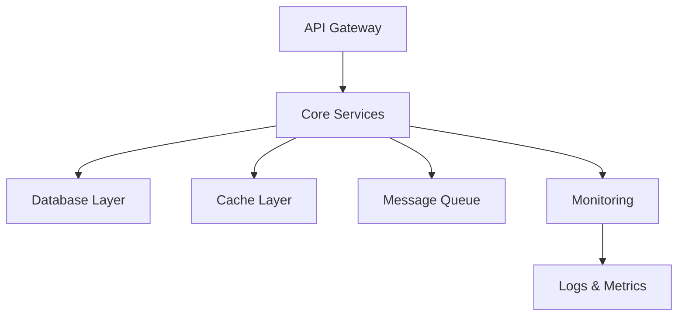

# 🚀 🌈 Core Services

<div align="center">


**The backbone of our infrastructure - where reliability meets performance** ⚡

[🚀 Quick Start](#-quick-start) • [📖 Documentation](#-documentation) • [🤝 Contributing](#-contributing) • [🐛 Issues](https://github.com/just-read-the-logs/core/issues)

</div>

---

## ✨ What is Core Services?

Core Services is the foundational layer that powers our entire ecosystem. Built with scalability, reliability, and developer experience in mind, it provides:

- 🔧 **Essential Infrastructure** - Rock-solid foundation services
- 📊 **Monitoring & Observability** - Because we actually read the logs
- 🔐 **Security First** - Built-in security patterns and best practices
- ⚡ **High Performance** - Optimized for speed and efficiency
- 🔄 **Auto-scaling** - Handles traffic spikes like a champ

## 🚀 Quick Start

Get up and running in under 5 minutes:

```bash
# Clone the repository
git clone https://github.com/just-read-the-logs/core.git
cd core

# Install dependencies
npm install

# Start development server
npm run dev

# Run tests
npm test
```

## 🏗️ Architecture



## 📦 Services Included

| Service | Description | Status |
|---------|-------------|--------|
| 🌐 **API Gateway** | Request routing and rate limiting | ✅ Active |
| 🗄️ **Database Service** | Data persistence and management | ✅ Active |
| 🚀 **Cache Service** | High-speed data caching | ✅ Active |
| 📨 **Message Queue** | Async communication backbone | ✅ Active |
| 📊 **Monitoring** | Health checks and metrics | ✅ Active |
| 🔐 **Auth Service** | Authentication and authorization | 🚧 In Progress |

## 🛠️ Tech Stack

<div align="center">


</div>

## 📖 Documentation

- 📚 [API Documentation](./docs/api.md)
- 🏗️ [Architecture Guide](./docs/architecture.md)
- 🚀 [Deployment Guide](./docs/deployment.md)
- 🔧 [Configuration Reference](./docs/configuration.md)
- 🐛 [Troubleshooting](./docs/troubleshooting.md)

## 🤝 Contributing

We love contributions! Here's how you can help:

1. 🍴 Fork the repository
2. 🌟 Create a feature branch (`git checkout -b feature/amazing-feature`)
3. 💾 Commit your changes (`git commit -m 'Add amazing feature'`)
4. 📤 Push to the branch (`git push origin feature/amazing-feature`)
5. 🎉 Open a Pull Request

### Development Guidelines

- ✅ Write tests for new features
- 📝 Update documentation
- 🎨 Follow our coding standards
- 🔍 Ensure all checks pass

## 📊 Performance Metrics

| Metric | Target | Current |
|--------|--------|---------|
| Response Time | < 100ms | 85ms ⚡ |
| Uptime | 99.9% | 99.95% 🎯 |
| Throughput | 10k req/s | 12k req/s 📈 |
| Error Rate | < 0.1% | 0.05% ✨ |

## 🔒 Security

Security is our top priority:

- 🛡️ Regular security audits
- 🔐 Encrypted data at rest and in transit
- 🔑 Multi-factor authentication
- 📋 Compliance with industry standards
- 🚨 Real-time threat monitoring

## 📈 Monitoring & Observability

Because we actually **just read the logs**:

- 📊 Real-time metrics dashboard
- 🔍 Distributed tracing
- 📝 Structured logging
- 🚨 Intelligent alerting
- 📈 Performance analytics

## 🌟 Why Choose Core Services?

- ⚡ **Lightning Fast** - Optimized for performance
- 🔧 **Developer Friendly** - Great DX with comprehensive tooling
- 📈 **Scalable** - Grows with your needs
- 🛡️ **Secure** - Security built-in, not bolted-on
- 🔍 **Observable** - Full visibility into system behavior
- 🤝 **Community Driven** - Open source and welcoming

## 📞 Support

Need help? We've got you covered:

- 📖 [Documentation](./docs/)
- 🐛 [Issue Tracker](https://github.com/just-read-the-logs/core/issues)
- 💬 [Discussions](https://github.com/just-read-the-logs/core/discussions)
- 📧 [Email Support](mailto:support@just-read-the-logs.com)

## 📄 License

This project is licensed under the MIT License - see the [LICENSE](LICENSE) file for details.

---

<div align="center">

**Made with ❤️ by the Just Read The Logs team**

[⭐ Star us on GitHub](https://github.com/just-read-the-logs/core) • [🐦 Follow us on Twitter](https://twitter.com/justreadthelogs) • [🌐 Visit our website](https://just-read-the-logs.com)

</div>
